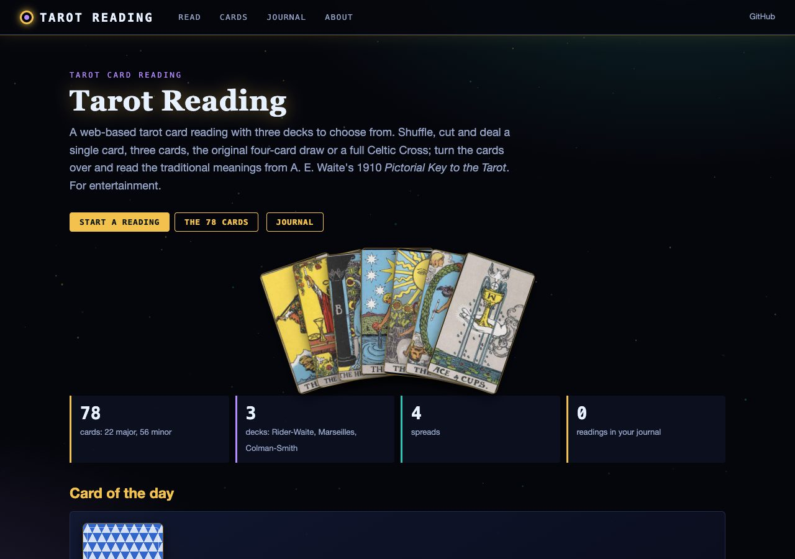
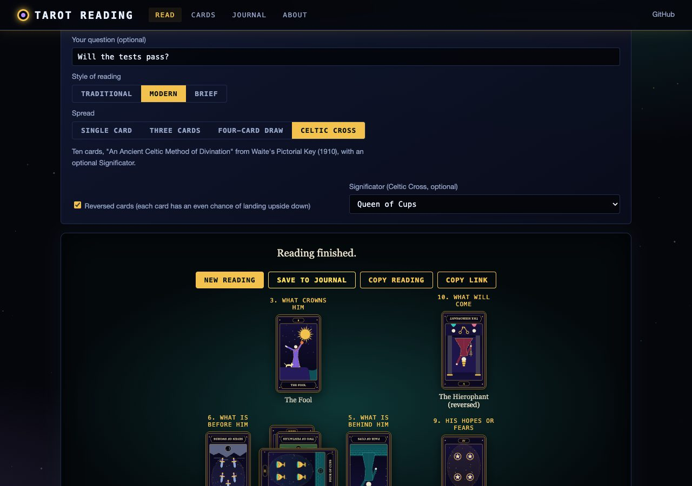
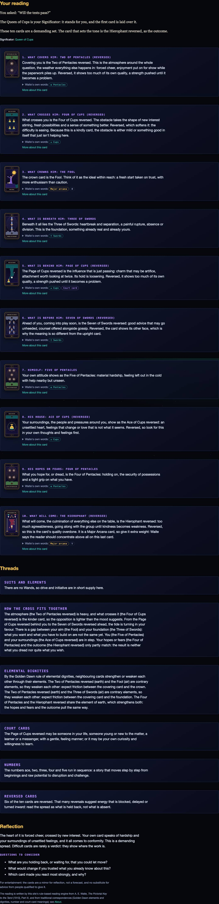
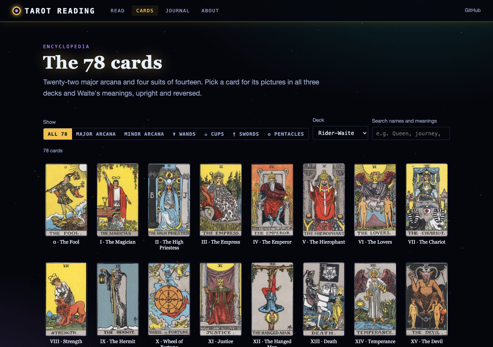
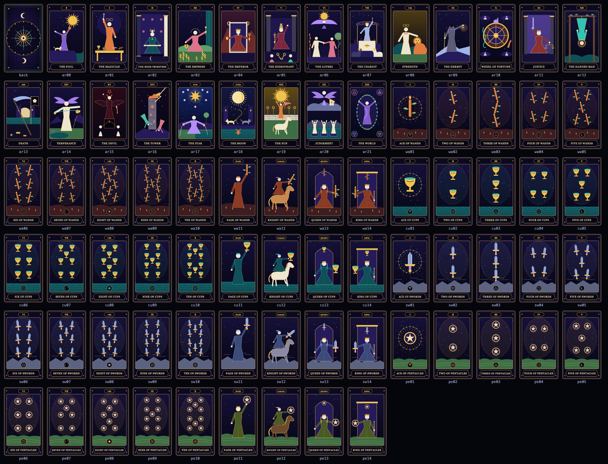
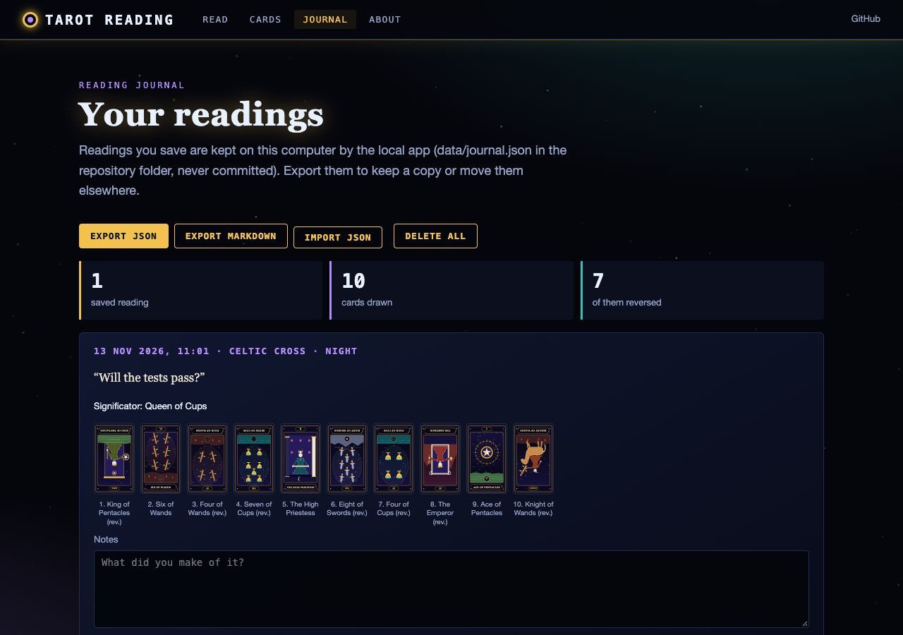

# Tarot Reading

A tarot card reading webpage with its own original 78-card deck, four spreads, animated shuffling and dealing, an encyclopedia
of all 78 cards with A. E. Waite's 1910 meanings, and a reading journal. For entertainment.

## Live Demo

Try it: [https://gddickinson.github.io/tarot/](https://gddickinson.github.io/tarot/)



## Features

- **An original deck**: 78 cards and a back drawn for this site as SVG by `tools/make_deck.mjs`: night-blue and gold,
  each major arcanum its own picture built from the card's traditional symbols, the minor arcana in suit emblems over
  the landscape of their element, with sixteen court figures.
- **Four spreads**: a single card; three cards (past, present, future); the original page's four-card draw; and the
  Celtic Cross exactly as Waite lays it out in *The Pictorial Key to the Tarot*, with an optional Significator.
- **At the table**: an animated riffle shuffle, a cut wherever you choose (or "let the cards decide"), cards dealt
  across the table, and a 3D flip as each card is turned over. Animations are switched off when the system asks for
  reduced motion.
- **Reversed cards**: each card has an even chance of landing upside down (as in the original page); this can be
  switched off.
- **A written reading**: after the deal, a reading of *this* spread for *this* question, in the voice of an
  experienced reader rather than a list of dictionary entries (see [Readings](#readings) below). Waite's own words
  for each card are a click away.
- **Meanings**: for every card, upright and reversed, quoted from Waite (1910), plus his "additional meanings" and
  his table of "the recurrence of cards in dealing".
- **Shareable readings**: the shuffle is seeded, so "Copy link" gives a link that deals the same cards again.
- **Card encyclopedia**: all 78 cards, filtered by major/minor arcana or suit, searchable by name and meaning; each
  card's page describes its picture and quotes Waite's description of the 1909 design.
- **Card of the day**: one card per date, the same for every visitor.
- **Reading journal**: save readings with your question and notes in the browser (localStorage), or, in the local
  app, in a file on your computer; export as JSON or Markdown and import a JSON export elsewhere. Nothing is sent
  anywhere else.



## Readings

When the cards are turned over, the page writes a reading below the table: an introduction at once (your question
and what it is about), a passage for each card as you turn it, and, once every card is face up, a summary, the
"threads" that run through the spread, and a closing reflection with two or three questions to think about.

- **Card x position.** Each position has a role (the Celtic Cross positions as Waite describes them: the atmosphere
  that covers you, the obstacle that crosses you, the aim that crowns you, the foundation beneath, the influence
  passing and the one coming, yourself, your surroundings, your hopes or fears, what will come; past, present and
  future; a short story for the four-card draw), and the card's meaning is woven into that role. A reversed card is
  read with nuance, not as "the opposite": blocked, turned inward, delayed, overdone, or (for heavy cards) easing.
- **The whole spread.** How many Major Arcana (big themes or everyday matters), which suits and elements lead or are
  missing, court cards as people or sides of yourself, Waite's table of recurring cards, number runs (and early or
  late stages), many or no reversals, Golden Dawn elemental dignities between neighbouring cards, classic pairings
  (the Tower and the Star...), and inside the Celtic Cross: cover against cross, past against future, crown against
  foundation, self against surroundings, hopes or fears against the outcome. A Significator is respected.
- **Your question** shapes the wording: its rough topic (love, work, money, a decision) is found from its words.
- **Three styles**: *Traditional* (Waite-flavoured, "the Querent"), *Modern* (plain, "you") and *Brief*.
- **Same link, same words.** The engine is rule-based and deterministic: the phrasing is chosen from the reading's
  seed, so a shared link (which carries the question and style) gives exactly the same text, while different
  readings do not read alike. **Copy reading** copies it as text; **Save to journal** keeps it with the reading
  (and in the JSON and Markdown exports).
- **What it will not do.** It is for entertainment. Questions about health, legal matters or money decisions get no
  forecast: the reading says tarot can't answer that and suggests a doctor, a lawyer or a financial adviser, and
  reads the cards only as a reflection. A question that mentions self-harm gets no reading at all, only a short line
  encouraging you to reach out to someone you trust or a local helpline. Waite's old recurrence readings about
  health are left out.

The engine is plain JavaScript (`static/reading_engine.js`, `reading_patterns.js`, and the text tables
`reading_cards.js`, `reading_lore.js`, `reading_positions.js`, `reading_phrases.js`), so it works on the static
site; the local app has a Python port (`web/reading.py`) behind `GET /api/reading`, checked against the JS on 50
readings. All the interpretive text was written for this site from Waite's meanings and the traditional
correspondences (see [THIRD_PARTY.md](THIRD_PARTY.md)).



**Optional, local app only:** `python run_web.py --ollama MODEL` adds an "Ask a local AI to elaborate" button that
sends the written reading to a model in a local [Ollama](https://ollama.com) (`http://127.0.0.1:11434`). It is off
by default, refuses the sensitive questions above, and does not exist on the static site.

## How to Use

1. Open **Read**, choose a deck and a spread (and, if you like, a question or a Significator).
2. Press **Shuffle deck**, then **Cut** (the slider chooses where) and **Deal**.
3. Press each card to turn it over, or **Reveal all**. The reading is written below the table as you go; choose
   its style (Traditional, Modern, Brief) at the top.
4. **Save to journal** keeps the reading and its text; **Copy reading** copies the text; **Copy link** shares it;
   **New reading** starts again.

The **Cards** page lists all 78 cards; press one for its pictures and meanings (press the big card to see it reversed;
the arrow keys go to the previous and next card).





## Running it locally

### As a local app (Python server)

```
pip install -r requirements-web.txt     # fastapi, uvicorn (+ httpx, pytest for the tests)
python run_web.py                       # http://127.0.0.1:8238  (--port to change)
```

The same pages, with a small FastAPI backend (`web/`): the server deals the readings (`/api/draw`, a Python port of
the page's seeded shuffle, so a share link gives the same cards on the server and on the static site), gives the card
of the day, serves the deck and Waite's texts, and keeps the reading journal in `data/journal.json` on your computer
(git-ignored; set `TAROT_DATA_DIR` to keep it elsewhere). It is the app Project Hub starts.

| API | What it returns |
|---|---|
| `GET /api/info` | counts (cards, spreads, saved readings), the source of the texts |
| `GET /api/deck`, `GET /api/cards/<id>` | the 78 cards in deck order with picture and meanings; one card with Waite's texts |
| `GET /api/spreads` | the four spreads and their positions |
| `GET /api/draw?spread=&seed=&cut=&rev=&sig=` | a seeded reading (random seed if left out; the seed is returned) + recurrences |
| `GET /api/reading?...&q=&tone=` | the same draw plus its written interpretation (question `q`, tone traditional/modern/brief) |
| `POST /api/elaborate` | optional (`--ollama MODEL`, this computer only): a local AI elaborates on the reading |
| `GET /api/daily?date=YYYY-MM-DD` | the card of the day |
| `GET /api/journal`; `POST /api/journal/{add,note,delete,import,clear}` | the reading journal (this computer only) |

The journal file is private to the computer running the app: its endpoints answer only requests from localhost
(403 otherwise). Other devices that open the app (if it is allowed on the local network) keep their own journal in
their browser, exactly as on the static site.



### As a static site

It is also a static site (HTML, CSS and plain ES modules; no build step), which is how GitHub Pages serves it from
the `master` branch root. `index.html` says `window.APP_STATIC = true`, so `static/static_api.js` answers the same
API calls in the browser (journal in localStorage); the local app serves the page with `APP_STATIC = false`. Serve the
folder with any web server, for example:

```
python3 -m http.server 8000
# then open http://127.0.0.1:8000/
```

Opening `index.html` directly from disk does not work, because browsers block ES modules on `file://` pages.

## Tests

```
node --test tests/*.test.mjs        # deck, seeded shuffle, cut, spreads, reversals, share links, Waite data, journal,
                                    # card art (79 SVGs, well-formed, deterministic, unique, size limits)
node tools/make_deck.mjs            # regenerate cards/*.svg and static/deck_desc.js (--check: compare only)
python tools/contact_sheet.py sheet.png   # contact sheet of the deck (Playwright)
python tests/smoke_test.py          # Playwright: every page without console errors, no overflow at 390 px,
                                    # a full Celtic Cross reading, journal save/export, share link
python tests/smoke_test.py --base http://127.0.0.1:8238   # the same against the local app
python -m pytest -q tests           # the Python app: API, journal, Python port == JS engine and reading engine
node tools/make_engine_fixture.mjs  # regenerate tests/fixtures/engine.json from the JS engine (--check: compare)
node tools/make_reading_fixture.mjs # regenerate tests/fixtures/readings.json from the reading engine (--check)
python scripts/screenshots.py --static [routes]   # quick route check (or --base URL for the local app)
```

The smoke test needs `pip install playwright` and a Chromium (`playwright install chromium`, or an installed Chrome).

## Project Structure

```
tarot/
├── index.html              # the page shell (header, nav, footer)
├── run_web.py              # starts the local app (uvicorn web.app:app on 127.0.0.1:8238)
├── requirements-web.txt    # pinned packages of the local app and its tests
├── web/                    # the Python backend: app.py (FastAPI), engine.py (port of engine.js), reading.py and
│                           # reading_patterns.py (port of the reading engine), texts.py, journal.py, elaborate.py
├── static/
│   ├── style.css, core.js  # shared dark theme and hash router (unchanged web kit files)
│   ├── style_app.css       # tarot palette, cards, 3D flip, table and spread layouts
│   ├── main.js             # page registration and starry background
│   ├── engine.js           # pure logic: deck, decks, seeded shuffle/cut/deal, spreads, recurrences, share links
│   ├── reading_engine.js, reading_patterns.js   # the reading engine (pure); reading_view.js shows it
│   ├── reading_cards.js, reading_lore.js, reading_positions.js, reading_phrases.js   # its text tables
│   ├── journal_model.js    # pure logic: journal entries, JSON (de)serialisation, Markdown export
│   ├── waite_pkt.js        # Waite's texts (generated by tools/extract_waite.py)
│   ├── deck_desc.js        # what each card picture shows (generated by tools/make_deck.mjs)
│   ├── static_api.js       # the API answered in the browser on the static site
│   ├── widgets.js, anim.js # card elements, storage, animations
│   └── home.js, read.js, cards.js, journal_page.js, about.js   # one module per page
├── cards/                  # the original deck: <id>.svg for 78 cards + back.svg (generated)
├── tools/make_deck.mjs, tools/deck/   # the deck generator (frame, figures, majors, minors)
├── tools/extract_waite.py  # rebuilds static/waite_pkt.js from Wikisource
├── tests/                  # node tests, pytest (test_web.py), fixtures/engine.json, the Playwright smoke test
└── docs/img/               # screenshots
```

See `INTERFACE.md` for a module-by-module map.

## Sources and licences

The card art is original to this repository (generated by `tools/make_deck.mjs`) and is under the repository's MIT
licence, as are the reading engine's texts, written for this site. The card meanings and descriptions are quoted from A. E. Waite, *The Pictorial Key to the Tarot* (1910),
public domain in the US, via [Wikisource](https://en.wikisource.org/wiki/The_Pictorial_Key_to_the_Tarot). See
[THIRD_PARTY.md](THIRD_PARTY.md).

## License

The code and the card art are released under the [MIT licence](LICENSE). Waite's quoted texts are public domain;
see [THIRD_PARTY.md](THIRD_PARTY.md).

## Credits

Developed by G.D. Dickinson

---

*Tarot Reading - Explore the mystical world of tarot with multiple decks and intuitive readings*
