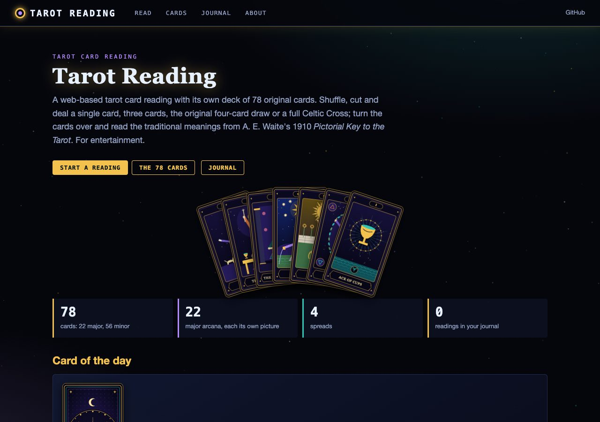
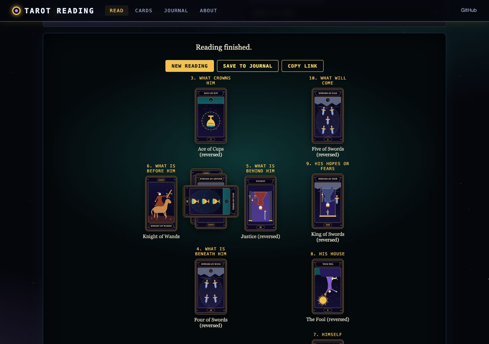
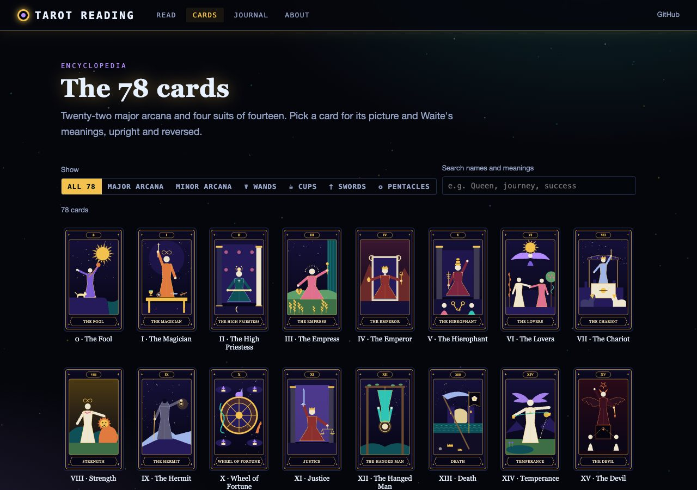
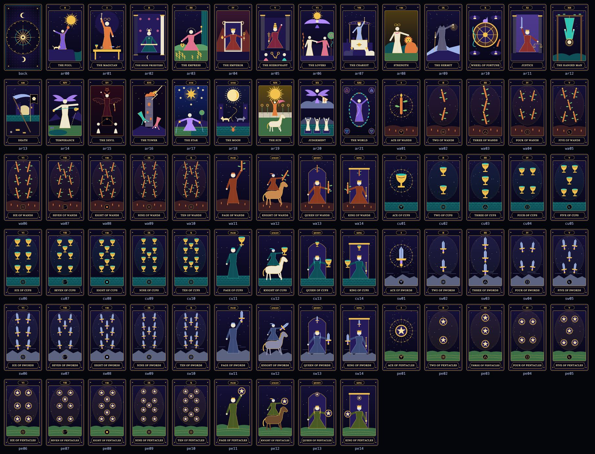

# Tarot Reading

A tarot card reading webpage with its own original 78-card deck, four spreads, animated shuffling and dealing, an encyclopedia
of all 78 cards with A. E. Waite's 1910 meanings, and a reading journal. For entertainment.

## Live Demo

Try it: [https://gddickinson.github.io/tarot/](https://gddickinson.github.io/tarot/)



## Features

- **An original deck**: 78 cards and a back drawn for this site as SVG by `tools/make_deck.mjs`: night-blue and gold,
  each major arcanum its own picture built from the card's traditional symbols, the minor arcana in suit emblems over
  the landscape of their element, with sixteen court figures.
- **Four spreads**: a single card; three cards (past, present, future); the original page's four-card draw; and the
  Celtic Cross exactly as Waite lays it out in *The Pictorial Key to the Tarot*, with an optional Significator.
- **At the table**: an animated riffle shuffle, a cut wherever you choose (or "let the cards decide"), cards dealt
  across the table, and a 3D flip as each card is turned over. Animations are switched off when the system asks for
  reduced motion.
- **Reversed cards**: each card has an even chance of landing upside down (as in the original page); this can be
  switched off.
- **Meanings**: for every card, upright and reversed, quoted from Waite (1910), plus his "additional meanings" and,
  when two or more cards of a rank turn up, his table of "the recurrence of cards in dealing".
- **Shareable readings**: the shuffle is seeded, so "Copy link" gives a link that deals the same cards again.
- **Card encyclopedia**: all 78 cards, filtered by major/minor arcana or suit, searchable by name and meaning; each
  card's page describes its picture and quotes Waite's description of the 1909 design.
- **Card of the day**: one card per date, the same for every visitor.
- **Reading journal**: save readings with your question and notes in the browser (localStorage); export as JSON or
  Markdown and import a JSON export elsewhere. Nothing is sent anywhere.



## How to Use

1. Open **Read**, choose a deck and a spread (and, if you like, a question or a Significator).
2. Press **Shuffle deck**, then **Cut** (the slider chooses where) and **Deal**.
3. Press each card to turn it over, or **Reveal all**. The meanings appear below the table.
4. **Save to journal** keeps the reading; **Copy link** shares it; **New reading** starts again.

The **Cards** page lists all 78 cards; press one for its pictures and meanings (press the big card to see it reversed;
the arrow keys go to the previous and next card).





## Running it locally

It is a static site (HTML, CSS and plain ES modules; no build step, no server code). Serve the folder with any web
server, for example:

```
python3 -m http.server 8000
# then open http://127.0.0.1:8000/
```

Opening `index.html` directly from disk does not work, because browsers block ES modules on `file://` pages. GitHub
Pages serves the `master` branch root as it is.

## Tests

```
node --test tests/*.test.mjs        # deck, seeded shuffle, cut, spreads, reversals, share links, Waite data, journal,
                                    # card art (79 SVGs, well-formed, deterministic, unique, size limits)
node tools/make_deck.mjs            # regenerate cards/*.svg and static/deck_desc.js (--check: compare only)
python tools/contact_sheet.py sheet.png   # contact sheet of the deck (Playwright)
python tests/smoke_test.py          # Playwright: every page without console errors, no overflow at 390 px,
                                    # a full Celtic Cross reading, journal save/export, share link
```

The smoke test needs `pip install playwright` and a Chromium (`playwright install chromium`, or an installed Chrome).

## Project Structure

```
tarot/
├── index.html              # the page shell (header, nav, footer)
├── static/
│   ├── style.css, core.js  # shared dark theme and hash router (unchanged web kit files)
│   ├── style_app.css       # tarot palette, cards, 3D flip, table and spread layouts
│   ├── main.js             # page registration and starry background
│   ├── engine.js           # pure logic: deck, decks, seeded shuffle/cut/deal, spreads, recurrences, share links
│   ├── journal_model.js    # pure logic: journal entries, JSON (de)serialisation, Markdown export
│   ├── waite_pkt.js        # Waite's texts (generated by tools/extract_waite.py)
│   ├── deck_desc.js        # what each card picture shows (generated by tools/make_deck.mjs)
│   ├── widgets.js, anim.js # card elements, storage, animations
│   └── home.js, read.js, cards.js, journal_page.js, about.js   # one module per page
├── cards/                  # the original deck: <id>.svg for 78 cards + back.svg (generated)
├── tools/make_deck.mjs, tools/deck/   # the deck generator (frame, figures, majors, minors)
├── tools/extract_waite.py  # rebuilds static/waite_pkt.js from Wikisource
├── tests/                  # node tests and the Playwright smoke test
└── docs/img/               # screenshots
```

See `INTERFACE.md` for a module-by-module map.

## Sources and licences

The card art is original to this repository (generated by `tools/make_deck.mjs`) and is under the repository's MIT
licence. The card meanings and descriptions are quoted from A. E. Waite, *The Pictorial Key to the Tarot* (1910),
public domain in the US, via [Wikisource](https://en.wikisource.org/wiki/The_Pictorial_Key_to_the_Tarot). See
[THIRD_PARTY.md](THIRD_PARTY.md).

## License

The code and the card art are released under the [MIT licence](LICENSE). Waite's quoted texts are public domain;
see [THIRD_PARTY.md](THIRD_PARTY.md).

## Credits

Developed by G.D. Dickinson

---

*Tarot Reading - Explore the mystical world of tarot with multiple decks and intuitive readings*
